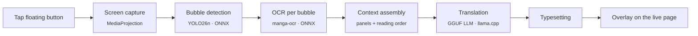

<div align="center">

# 読む Yomu

**Read any manga. Offline. In one tap.**

On-device manga and comics translation for Android, from Japanese, Chinese, Korean, Latin-script or Cyrillic-script pages into English, Brazilian Portuguese, Spanish, French, German or Russian.
Tap once over any manga page, in any app, and read it in your language. Nothing leaves your phone.


**[Download the latest APK](https://github.com/artsaraiva/yomu/releases/latest)**

<a href="https://apps.obtainium.imranr.dev/redirect?r=obtainium://app/%7B%22id%22%3A%22com.yomu.app%22%2C%22url%22%3A%22https%3A%2F%2Fgithub.com%2Fartsaraiva%2Fyomu%22%2C%22author%22%3A%22artsaraiva%22%2C%22name%22%3A%22Yomu%22%7D"></a>

</div>

> [!IMPORTANT]
> **Before you install**
> - **Android 8.0 or newer on a 64-bit ARM phone.** Tested on an 8 GB phone (Galaxy S23), where the default model peaks at about 2 GB of RAM. Phones with less RAM are untested; [tell us how yours does](https://github.com/artsaraiva/yomu/issues/new?template=bug_report.yml).
> - **About 1.1 GB of models download on first launch, over Wi-Fi or mobile data.** Keep about 1.5 GB free. After that, Yomu never uses the network.
> - **A page takes seconds, not milliseconds:** about 15 s on a Galaxy S23 with the default model.
> - **Japanese reads best.** Other sources use a PP-OCRv5 line reader for horizontal text; pick it in the OCR slot. Machine translation from a small on-device model makes mistakes.

---

## What's new

Changes in this fork since it branched from [`artsaraiva/yomu`](https://github.com/artsaraiva/yomu) at [`ba91c31`](https://github.com/artsaraiva/yomu/commit/ba91c31).

**0.3.5**

- **Many-column narration boxes are read.** manga-ocr squeezes every crop to 224 × 224 px, so a caption with a dozen vertical columns came back garbled and was skipped as unsure. A block of four or more vertical columns is now read two columns at a time, right to left. A 13-column box went from 0.74 confidence and garbage to 0.93 and clean text.
- **Long one-line captions are read.** A single line many times wider than tall, such as white text on a black bar, was squeezed flat the same way. It is now cut between characters into pieces about five characters long. A test caption went from 0.68 to 0.93.

**0.3.1**

- **Choice of bubble detector.** The Detection slot also offers [`ogkalu/comic-text-and-bubble-detector`](https://huggingface.co/ogkalu/comic-text-and-bubble-detector) (RT-DETR-v2 v4-s, int8, 11 MB, Apache-2.0), marked Experimental. It finds text in rectangular captions that the default YOLO26n misses, for example 0.95 against 0.09 on a boxed monologue. YOLO26n stays the default. See [ADR-0020](docs/adr/0020-selectable-text-detector.md).
- **A new detector takes over at once.** Picking another detector used to need an overlay restart; now the next page uses it.

**0.2.35**

- **Russian target.** Russian joins English, Brazilian Portuguese, Spanish, French and German.
- **More source scripts.** Chinese and English, Korean, Latin-script and Cyrillic-script pages are read with PP-OCRv5 line recognizers. The OCR model you pick sets the source language, and Japanese keeps manga-ocr.
- **TranslateGemma 4B** joins the translation catalog as Experimental and Multilingual, translating line by line in its own trained prompt format.
- **Gemma 4 is labelled Multilingual**, so it can be picked for every target language, Russian included.
- **Build:** Android Gradle Plugin 9.1, Gradle 9.3.1, built-in Kotlin, Hilt 2.59.2, KSP 2.3.6 and Room 2.8.5.

## See it in action

<p align="center">
  
</p>

<table>
  <tr>
    <th align="center">Before</th>
    <th align="center">After one tap</th>
  </tr>
  <tr>
    <td></td>
    <td></td>
  </tr>
</table>

<sub>Unedited output from the default model (Qwen2.5 1.5B), recorded in real time on an Android emulator. The emulator runs on a desktop CPU, so a phone takes longer. Manga: ブラックジャックによろしく 佐藤秀峰 (Give My Regards to Black Jack, SHUHO SATO), used under the author's free secondary-use licence.</sub>

## Table of contents

- [What's new](#whats-new)
- [Features](#features)
- [How it works](#how-it-works)
- [Models](#models)
- [Getting started](#getting-started)
- [Usage](#usage)
- [Project structure](#project-structure)
- [Testing](#testing)
- [Documentation](#documentation)
- [Contributing](#contributing)
- [License](#license)

## Features

- **Works over any app.** A floating button sits on top of your reader, browser or gallery. Yomu captures the screen only when you tap it.
- **Six target languages.** English, Brazilian Portuguese, Spanish, French, German or Russian. Switch from settings or the floating button.
- **Five source families.** Japanese (manga-ocr), Chinese and English, Korean, Latin script and Cyrillic script (PP-OCRv5). The OCR model you pick sets the source.
- **Fully on-device.** Bubble detection, OCR and translation all run locally. No account, no API key, and no usage after the model download.
- **Page-level context.** Every bubble on the page goes to the LLM in one call, in reading order, so pronouns and tone hold across a conversation.
- **Manga-aware typesetting.** Font size and line wrapping are fitted to each bubble's bounds.
- **Choice of model.** Pick from a curated list of GGUF translation models. Models that won't fit your device's RAM are hidden.
- **Cancel any time.** Tap the floating button again to stop a translation that's still running.
- **Tunable.** Bubble confidence threshold, font scale, generation profile, resource limits, and a live resource readout.

## How it works



| Stage | Where | What it does |
|---|---|---|
| Capture | `app/capture` | Grabs a single frame of the screen through `MediaProjection` |
| Detection | `pipeline/bubble` | Finds speech bubbles and in-panel text with a single-class YOLO detector |
| OCR | `pipeline/ocr` | Reads each cropped bubble: manga-ocr for Japanese, or a PP-OCRv5 recognizer line by line for other sources |
| Context | `pipeline/context` | Groups bubbles into panels and orders them right-to-left, top-to-bottom |
| Translation | `ml/` | Sends the whole page to the LLM in the translation slot, using grammar-constrained, id-keyed output where the model supports it |
| Typesetting | `pipeline/typesetting` | Wraps and sizes the English text to fit each bubble |
| Render | `app/overlay` | Draws the typeset bubbles over the page in a system overlay window |

## Models

Yomu downloads every model on first launch. Each download is pinned to an exact Hugging Face revision.

| Slot | Model | Licence |
|---|---|---|
| Bubble detection | [`Kiuyha/Manga-Bubble-YOLO`](https://huggingface.co/Kiuyha/Manga-Bubble-YOLO) (yolo26n, ONNX) | AGPL-3.0, from its Ultralytics YOLO26 base; see [ADR-0007](docs/adr/0007-bubble-text-detection-approach.md) |
| Bubble detection (Experimental) | [`ogkalu/comic-text-and-bubble-detector`](https://huggingface.co/ogkalu/comic-text-and-bubble-detector) (RT-DETR-v2 v4-s, int8 ONNX); also finds text in rectangular captions | Apache-2.0; see [ADR-0020](docs/adr/0020-selectable-text-detector.md) |
| OCR | [`artsaraiva/manga-ocr-2025-onnx-past`](https://huggingface.co/artsaraiva/manga-ocr-2025-onnx-past/tree/151898756903f03a2682fa6be4507dfeff71fb7e) (manga-ocr-2025 with past key values) | Apache-2.0 |
| OCR (other sources) | [PaddlePaddle PP-OCRv5 mobile recognizers](https://huggingface.co/PaddlePaddle) (Chinese and English, Korean, Latin, Cyrillic; ONNX) | Apache-2.0 |
| Translation (default) | **Qwen2.5 1.5B Instruct** Q4_K_M | Apache-2.0 |
| Translation | CAT-Translate 1.4B Q4_K_M | MIT |
| Translation (low storage) | CAT-Translate 0.8B Q4_K_M | MIT |
| Translation (custom) | Any GGUF you provide. Allowed but unsupported. | Its own |

Why these models were picked: [ADR-0010](docs/adr/0010-qwen-default-cat-demoted-to-floor.md), [ADR-0016](docs/adr/0016-llm-is-the-only-translator.md), [ADR-0001](docs/adr/0001-custom-model-permissiveness.md).

## Getting started

### Install

Download `yomu-<version>.apk` from the [latest release](https://github.com/artsaraiva/yomu/releases/latest) on your phone and open it. Android asks once to allow installs from your browser or file manager.

To get updates automatically, install it with [Obtainium](https://github.com/ImranR98/Obtainium) instead: tap the badge above, or add `https://github.com/artsaraiva/yomu` as an app in Obtainium.

### Build from source

#### Requirements

| | |
|---|---|
| Android device | Android 8.0 (API 26) or newer, `arm64-v8a` or `x86_64` |
| JDK | 17 |
| Android SDK | compileSdk 36, plus NDK and CMake 3.22.1 (for llama.cpp) |
| Storage | about 1.5 GB free for the default models |

#### Build

```bash
git clone --recursive https://github.com/artsaraiva/yomu.git
cd yomu

# Already cloned without --recursive? Fetch llama.cpp:
git submodule update --init --recursive

# local.properties must point at your SDK
echo "sdk.dir=$HOME/Library/Android/sdk" > local.properties

./gradlew assembleDebug
./gradlew installDebug
```

## Usage

1. **Open Yomu** and let setup download the detection, OCR and translation models.
2. **Grant permissions** when asked: *Display over other apps* for the floating button, and *Screen capture* for reading the page.
3. **Start the overlay** from the Home screen.
4. **Open a manga page** in any app.
5. **Tap the floating button.** Status appears while it runs, then translated bubbles cover the Japanese ones.
6. **Tap again** to cancel. To stop the overlay, hold the button and tap *Stop service*.

Settings let you pick the target language, switch translation models, adjust the bubble confidence threshold and font scale, and cap the CPU and memory the model uses.

## Project structure

```
yomu/
├── app/        Android app: Compose UI, overlay service, screen capture, model downloads (Hilt, Room)
├── pipeline/   Page pipeline: detection → OCR → context → translation → typesetting
├── ml/         Inference: ONNX Runtime wrapper, llama.cpp JNI bridge (llama.cpp as a submodule)
├── core/       Shared types, constants, Result
├── scripts/    Device speed benchmark
└── docs/       ADRs, design system, agent docs
```

## Testing

```bash
./gradlew lint test assembleDebug      # what CI runs on every pull request
./gradlew connectedAndroidTest         # instrumented tests (needs a device or emulator)
scripts/run-speed-benchmark.sh         # per-stage timings and peak memory for every catalog model
```

The speed benchmark only reports numbers and never fails on them. Run it on a real phone when you change a model or the inference runtime, since emulator timings don't match phones.

## Documentation

| Doc | Contents |
|---|---|
| [`CONTEXT.md`](CONTEXT.md) | Domain language: deliverable, fit budget, translation slot, typeset bubble |
| [`docs/adr/`](docs/adr) | Architecture decision records: why each model, threshold and trade-off was chosen |
| [`docs/design/paper-mache-visual-system.md`](docs/design/paper-mache-visual-system.md) | The paper-mâché visual system for the app's screens and overlay controls |
| [`AGENTS.md`](AGENTS.md) | Git, issue and code conventions |

## Contributing

Bug reports, ideas and pull requests are welcome. Ask questions in [Discussions](https://github.com/artsaraiva/yomu/discussions). [`CONTRIBUTING.md`](CONTRIBUTING.md) covers building, the issue-first workflow and what CI checks.

## License

Yomu is licensed under the [GNU Affero General Public License v3.0](LICENSE) ([ADR-0019](docs/adr/0019-yomu-is-agpl-open-source.md)). Contributions are accepted under the same licence; there is no CLA. Each model is covered by its own licence (see [Models](#models)).

<div align="center">
<sub>読む (yomu): "to read"</sub>
</div>
