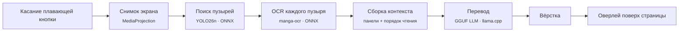

<div align="center">

# 読む Yomu

[English](README.md) · **Русский**

**Читай любую мангу. Без интернета. В одно касание.**

Перевод манги и комиксов прямо на телефоне Android: со страниц на японском, китайском, корейском, на латинице или кириллице на английский, бразильский португальский, испанский, французский, немецкий или русский.
Одно касание поверх страницы манги в любом приложении — и вы читаете её на своём языке. Ничего не покидает телефон.


**[Скачать последний APK](https://github.com/iBog/yomu/releases/latest)**

<a href="https://apps.obtainium.imranr.dev/redirect?r=obtainium://app/%7B%22id%22%3A%22com.yomu.app%22%2C%22url%22%3A%22https%3A%2F%2Fgithub.com%2FiBog%2Fyomu%22%2C%22author%22%3A%22iBog%22%2C%22name%22%3A%22Yomu%22%7D"></a>

</div>

> [!IMPORTANT]
> **Перед установкой**
> - **Android 8.0 или новее на 64-битном ARM-телефоне.** Проверено на телефоне с 8 ГБ памяти (Galaxy S23): модель по умолчанию занимает до 2 ГБ оперативной памяти. На телефонах с меньшим объёмом памяти не проверялось — [расскажите, как работает у вас](https://github.com/artsaraiva/yomu/issues/new?template=bug_report.yml).
> - **При первом запуске скачивается около 1,1 ГБ моделей, по Wi-Fi или мобильной сети.** Оставьте свободными около 1,5 ГБ. После этого Yomu больше не обращается к сети.
> - **Страница переводится секунды, а не миллисекунды:** около 15 с на Galaxy S23 с моделью по умолчанию.
> - **Лучше всего читается японский.** Для остальных языков используется построчный распознаватель PP-OCRv5 для горизонтального текста — выберите его в слоте OCR. Небольшая модель на телефоне переводит с ошибками.

---

## Что нового

Изменения в этом форке с момента ответвления от [`artsaraiva/yomu`](https://github.com/artsaraiva/yomu) на коммите [`ba91c31`](https://github.com/artsaraiva/yomu/commit/ba91c31).

**0.3.5**

- **Читаются рамки с текстом в много колонок.** manga-ocr сжимает каждый вырезанный фрагмент до 224 × 224 px, поэтому подпись в десяток вертикальных колонок распознавалась в мусор и отбрасывалась как неуверенная. Теперь блок из четырёх и более вертикальных колонок читается по две колонки, справа налево. Рамка из 13 колонок: было 0,74 и мусор, стало 0,93 и чистый текст.
- **Читаются длинные подписи в одну строку.** Строка, которая во много раз шире своей высоты (например, белый текст на чёрной плашке), сплющивалась так же. Теперь она режется между символами на куски примерно по пять знаков. Тестовая подпись: было 0,68, стало 0,93.

**0.3.1**

- **Выбор детектора пузырей.** В слоте Detection появился [`ogkalu/comic-text-and-bubble-detector`](https://huggingface.co/ogkalu/comic-text-and-bubble-detector) (RT-DETR-v2 v4-s, int8, 11 МБ, Apache-2.0) с пометкой Experimental. Он находит текст в прямоугольных рамках, который пропускает стандартный YOLO26n: например, 0,95 против 0,09 на монологе в рамке. По умолчанию остаётся YOLO26n. Подробнее — [ADR-0020](docs/adr/0020-selectable-text-detector.md).
- **Новый детектор подхватывается сразу.** Раньше после смены детектора нужно было перезапустить оверлей, теперь новая модель работает уже на следующей странице.

**0.2.35**

- **Перевод на русский.** Русский добавлен к английскому, бразильскому португальскому, испанскому, французскому и немецкому.
- **Больше языков оригинала.** Страницы на китайском и английском, корейском, латинице и кириллице читаются построчными распознавателями PP-OCRv5. Язык оригинала задаётся выбранной моделью OCR, для японского остаётся manga-ocr.
- **TranslateGemma 4B** добавлена в каталог переводчиков как Experimental и Multilingual. Она переводит построчно в собственном формате промпта, на котором обучалась.
- **Gemma 4 помечена как Multilingual**, поэтому её можно выбрать для любого языка перевода, включая русский.
- **Сборка:** Android Gradle Plugin 9.1, Gradle 9.3.1, встроенный Kotlin, Hilt 2.59.2, KSP 2.3.6 и Room 2.8.5.

## Как это выглядит

<p align="center">
  
</p>

<table>
  <tr>
    <th align="center">До</th>
    <th align="center">После одного касания</th>
  </tr>
  <tr>
    <td></td>
    <td></td>
  </tr>
</table>

<sub>Результат модели по умолчанию (Qwen2.5 1.5B) без правок, записан в реальном времени на эмуляторе Android. Эмулятор работает на процессоре компьютера, на телефоне перевод идёт дольше. Манга: ブラックジャックによろしく 佐藤秀峰 (Give My Regards to Black Jack, SHUHO SATO), используется по свободной лицензии автора на вторичное использование.</sub>

## Содержание

- [Что нового](#что-нового)
- [Возможности](#возможности)
- [Как это работает](#как-это-работает)
- [Модели](#модели)
- [Начало работы](#начало-работы)
- [Использование](#использование)
- [Структура проекта](#структура-проекта)
- [Тестирование](#тестирование)
- [Документация](#документация)
- [Участие в разработке](#участие-в-разработке)
- [Лицензия](#лицензия)

## Возможности

- **Работает поверх любого приложения.** Плавающая кнопка висит поверх читалки, браузера или галереи. Yomu снимает экран только когда вы на неё нажимаете.
- **Шесть языков перевода.** Английский, бразильский португальский, испанский, французский, немецкий и русский. Переключаются в настройках или с плавающей кнопки.
- **Пять групп языков оригинала.** Японский (manga-ocr), китайский и английский, корейский, латиница и кириллица (PP-OCRv5). Язык оригинала задаётся выбранной моделью OCR.
- **Всё на устройстве.** Поиск пузырей, распознавание и перевод выполняются локально. Без аккаунта, без API-ключа и без сети после скачивания моделей.
- **Контекст всей страницы.** Все пузыри страницы уходят в LLM одним запросом, в порядке чтения, поэтому местоимения и тон сохраняются на протяжении всего диалога.
- **Вёрстка под мангу.** Размер шрифта и переносы строк подбираются под границы каждого пузыря.
- **Выбор модели.** Можно выбрать переводчик из отобранного списка GGUF-моделей. Модели, которым не хватит памяти вашего телефона, скрыты.
- **Отмена в любой момент.** Нажмите плавающую кнопку ещё раз, чтобы остановить идущий перевод.
- **Настройки.** Порог уверенности детектора, масштаб шрифта, профиль генерации, ограничения ресурсов и живой индикатор их расхода.

## Как это работает



| Этап | Где | Что делает |
|---|---|---|
| Снимок | `app/capture` | Снимает один кадр экрана через `MediaProjection` |
| Поиск | `pipeline/bubble` | Находит пузыри и текст внутри панелей детектором текста |
| OCR | `pipeline/ocr` | Читает каждый вырезанный пузырь: manga-ocr для японского или построчно распознавателем PP-OCRv5 для остальных языков |
| Контекст | `pipeline/context` | Группирует пузыри по панелям и упорядочивает справа налево, сверху вниз |
| Перевод | `ml/` | Отправляет всю страницу в LLM из слота перевода; если модель это поддерживает, ответ ограничен грамматикой и привязан к id пузырей |
| Вёрстка | `pipeline/typesetting` | Переносит и подбирает размер переведённого текста под каждый пузырь |
| Отрисовка | `app/overlay` | Рисует свёрстанные пузыри поверх страницы в системном окне оверлея |

## Модели

Yomu скачивает все модели при первом запуске. Каждая загрузка привязана к точной ревизии на Hugging Face.

| Слот | Модель | Лицензия |
|---|---|---|
| Поиск пузырей | [`Kiuyha/Manga-Bubble-YOLO`](https://huggingface.co/Kiuyha/Manga-Bubble-YOLO) (yolo26n, ONNX) | AGPL-3.0, от базы Ultralytics YOLO26; см. [ADR-0007](docs/adr/0007-bubble-text-detection-approach.md) |
| Поиск пузырей (Experimental) | [`ogkalu/comic-text-and-bubble-detector`](https://huggingface.co/ogkalu/comic-text-and-bubble-detector) (RT-DETR-v2 v4-s, int8 ONNX); находит и текст в прямоугольных рамках | Apache-2.0; см. [ADR-0020](docs/adr/0020-selectable-text-detector.md) |
| OCR | [`artsaraiva/manga-ocr-2025-onnx-past`](https://huggingface.co/artsaraiva/manga-ocr-2025-onnx-past/tree/151898756903f03a2682fa6be4507dfeff71fb7e) (manga-ocr-2025 с past key values) | Apache-2.0 |
| OCR (другие языки) | [Мобильные распознаватели PaddlePaddle PP-OCRv5](https://huggingface.co/PaddlePaddle) (китайский и английский, корейский, латиница, кириллица; ONNX) | Apache-2.0 |
| Перевод (по умолчанию) | **Qwen2.5 1.5B Instruct** Q4_K_M | Apache-2.0 |
| Перевод | CAT-Translate 1.4B Q4_K_M | MIT |
| Перевод (мало места) | CAT-Translate 0.8B Q4_K_M | MIT |
| Перевод (своя модель) | Любой ваш GGUF. Разрешено, но не поддерживается. | Своя |

Почему выбраны эти модели: [ADR-0010](docs/adr/0010-qwen-default-cat-demoted-to-floor.md), [ADR-0016](docs/adr/0016-llm-is-the-only-translator.md), [ADR-0001](docs/adr/0001-custom-model-permissiveness.md).

## Начало работы

### Установка

Скачайте на телефон `yomu-<версия>.apk` из [последнего релиза](https://github.com/iBog/yomu/releases/latest) и откройте его. Android один раз спросит разрешение на установку из браузера или файлового менеджера.

Чтобы получать обновления автоматически, установите приложение через [Obtainium](https://github.com/ImranR98/Obtainium): нажмите на значок выше или добавьте `https://github.com/iBog/yomu` как приложение в Obtainium.

### Сборка из исходников

#### Требования

| | |
|---|---|
| Устройство | Android 8.0 (API 26) или новее, `arm64-v8a` или `x86_64` |
| JDK | 17 |
| Android SDK | compileSdk 36, а также NDK и CMake 3.22.1 (для llama.cpp) |
| Место | около 1,5 ГБ свободно для моделей по умолчанию |

#### Сборка

```bash
git clone --recursive https://github.com/iBog/yomu.git
cd yomu

# Уже клонировали без --recursive? Подтяните llama.cpp:
git submodule update --init --recursive

# local.properties должен указывать на ваш SDK
echo "sdk.dir=$HOME/Library/Android/sdk" > local.properties

./gradlew assembleDebug
./gradlew installDebug
```

## Использование

1. **Откройте Yomu** и дайте мастеру настройки скачать модели поиска, OCR и перевода.
2. **Выдайте разрешения**, когда попросит: *Поверх других приложений* для плавающей кнопки и *Запись экрана* для чтения страницы.
3. **Запустите оверлей** с главного экрана.
4. **Откройте страницу манги** в любом приложении.
5. **Нажмите плавающую кнопку.** Пока идёт работа, показывается статус, затем переведённые пузыри закрывают оригинальные.
6. **Нажмите ещё раз**, чтобы отменить. Чтобы остановить оверлей, удерживайте кнопку и выберите *Stop service*.

В настройках можно выбрать язык перевода, сменить модели, изменить порог уверенности детектора и масштаб шрифта, а также ограничить процессор и память для модели.

## Структура проекта

```
yomu/
├── app/        Android-приложение: Compose UI, сервис оверлея, снимок экрана, загрузка моделей (Hilt, Room)
├── pipeline/   Конвейер страницы: поиск → OCR → контекст → перевод → вёрстка
├── ml/         Инференс: обёртка ONNX Runtime, JNI-мост к llama.cpp (llama.cpp — сабмодуль)
├── core/       Общие типы, константы, Result
├── scripts/    Бенчмарк скорости на устройстве
└── docs/       ADR, дизайн-система, документы для агентов
```

## Тестирование

```bash
./gradlew lint test assembleDebug      # то, что CI запускает на каждый pull request
./gradlew connectedAndroidTest         # инструментальные тесты (нужно устройство или эмулятор)
scripts/run-speed-benchmark.sh         # время по этапам и пиковая память для каждой модели каталога
```

Бенчмарк скорости только сообщает цифры и никогда не падает из-за них. Запускайте его на настоящем телефоне, когда меняете модель или среду инференса: время на эмуляторе с телефонным не совпадает.

## Документация

| Документ | Содержание |
|---|---|
| [`CONTEXT.md`](CONTEXT.md) | Термины предметной области: deliverable, fit budget, translation slot, typeset bubble |
| [`docs/adr/`](docs/adr) | Записи архитектурных решений: почему выбраны каждая модель, порог и компромисс |
| [`docs/design/paper-mache-visual-system.md`](docs/design/paper-mache-visual-system.md) | Визуальная система «папье-маше» для экранов приложения и элементов оверлея |
| [`AGENTS.md`](AGENTS.md) | Правила для git, задач и кода |

Документация в репозитории написана на английском.

## Участие в разработке

Сообщения об ошибках, идеи и pull request'ы приветствуются. Вопросы задавайте в [Discussions](https://github.com/artsaraiva/yomu/discussions) основного проекта. В [`CONTRIBUTING.md`](CONTRIBUTING.md) описаны сборка, порядок «сначала issue» и проверки CI.

## Лицензия

Yomu распространяется под [GNU Affero General Public License v3.0](LICENSE) ([ADR-0019](docs/adr/0019-yomu-is-agpl-open-source.md)). Вклад принимается под той же лицензией, CLA нет. У каждой модели своя лицензия (см. [Модели](#модели)).

<div align="center">
<sub>読む (yomu): «читать»</sub>
</div>
